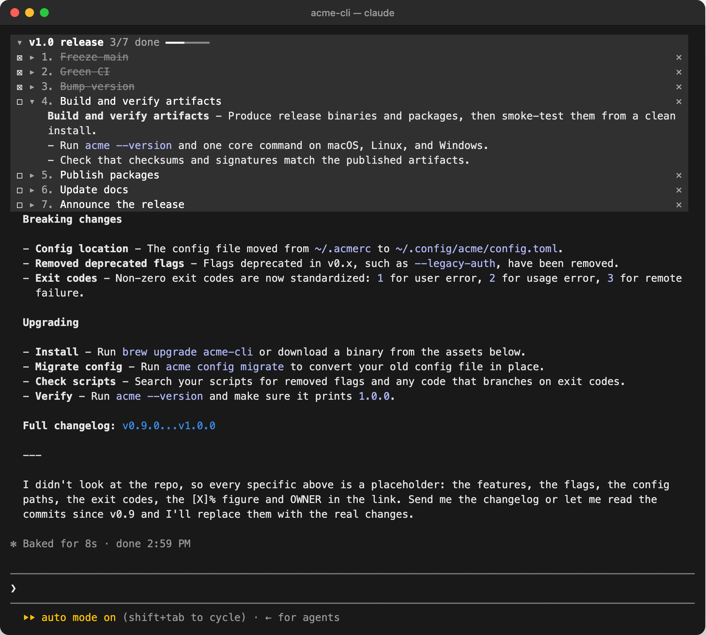
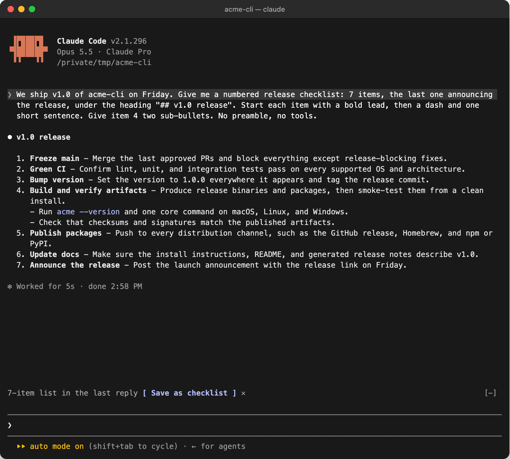
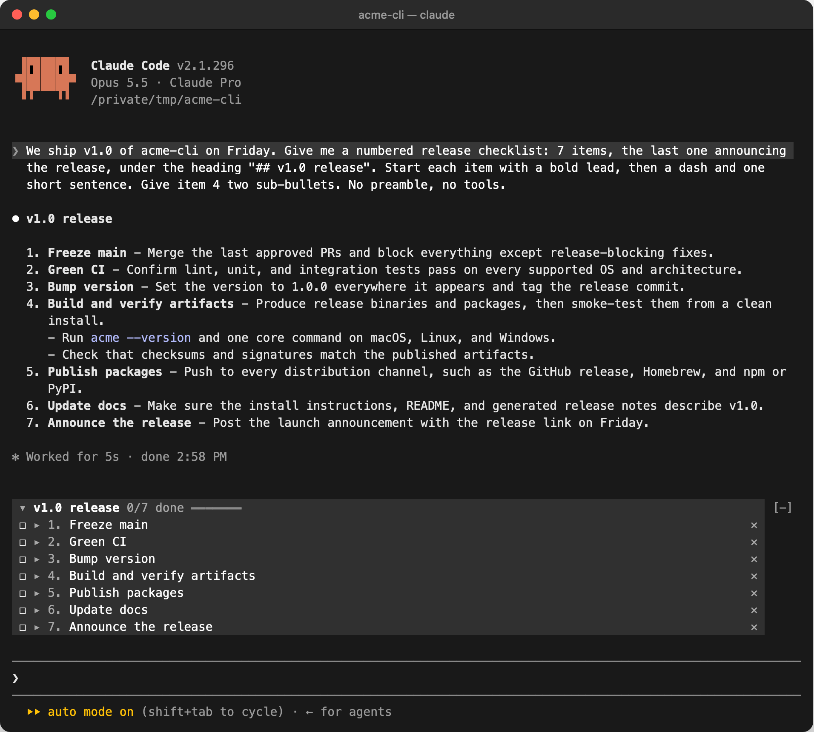

# Claude Checklist

A Claude Code mod that turns a list from Claude's reply into a checklist pinned to the top of your session, so the plan stays in view while the conversation scrolls on.

[](LICENSE)
[](https://github.com/tchoedak/claude-checklist/stargazers)



## Install

Inside Claude Code, run:

```
/plugin marketplace add tchoedak/claude-checklist
/plugin install checklist
/reload-plugins
```

That's it. The next time Claude replies with a list, a **Save as checklist** button appears above the prompt.

<details>
<summary><strong>Prefer the terminal?</strong></summary>

```bash
claude plugin marketplace add tchoedak/claude-checklist
claude plugin install checklist@claude-checklist
```

Then run `/reload-plugins` inside a session, or start a new one.

</details>

## What You See

When a reply has a list of two or more items, the mod offers it above the prompt:



Save it and it sits above the prompt, titled after the list's heading:



Once the conversation scrolls past it, it pins to the top of the screen, as in the picture at the top of this page.

- **Pinned while you scroll.** The checklist sits on the top edge of the transcript whatever is scrolled beneath it. When nothing is scrolled off the top, it moves to the band above the prompt instead.
- **Short items, full text on demand.** Each item shows its bold lead or first clause. Click it to expand the item's full markdown, nested bullets included.
- **Check off, remove, undo.** Click `☐` to mark an item done and watch the progress bar fill. `✕` removes an item, and `↶ undo` puts it back.
- **Collapse to one line.** Click the title to fold the checklist down to its title and progress.
- **Keeps the list's own numbers.** Item `3.` stays `3.`, so "do #3" still means the same thing to you and to Claude.
- **Survives a resume.** The checklist is saved per session, so `claude --resume` brings it back.

## Commands

| Command | What it does |
|---|---|
| `/checklist` | Shows the current checklist, or saves Claude's latest list if there isn't one |
| `/checklist save` | Saves the list in your mouse selection, else Claude's latest list, replacing the current checklist |
| `/checklist clear` | Removes the checklist |

## Which List It Picks

A reply often has more than one list. The mod takes the **last numbered list**, since plans and next steps are usually numbered and usually last, and falls back to the last bulleted list. It skips anything inside code fences. The heading or `Label:` line right above the list becomes the checklist's title.

To pick a different list, select it with the mouse and run `/checklist save`. A selection that starts partway through the reply works, including the `⏺` and `⎿` glyphs the terminal draws.

Markdown task boxes are read too: `- [x] shipped` starts out checked.

## How It Works

Claude Checklist is a [mod](https://code.claude.com/docs/en/plugins/mods/overview):

1. On `turn.complete` it parses the answer for lists and, if it finds one with two or more items, offers it in the band above the prompt.
2. Saving stores the checklist in plugin state, and in the mod's store keyed by session id so a resumed session finds it again. Only the 50 most recent sessions are kept.
3. Every transcript row reports which of its lines are on screen. The row cut off by the top of the viewport draws the checklist over that edge with absolute positioning, which is what keeps it pinned. Rows below paint over anything that spills past that row, so the checklist keeps to the rows it has on screen: when that row is short, you see the title, the items that fit and `… N more`. When no row is cut off, the band above the prompt draws it instead.

## Security

Claude Checklist is local-only. It makes no network requests and runs no processes. It reads Claude's replies in the current session and your mouse selection when you run `/checklist save`, and writes the checklist to Claude Code's per-plugin store.

Run `claude plugin validate` on the repo to see every event it hooks and every call it makes.

## Requirements

- Claude Code with mods support. Built and tested on v2.1.296.

## Troubleshooting

**No "Save as checklist" button appears.** The reply needs a list with at least two items, outside a code fence. Run `/checklist` to save the latest list directly. If that says the command is unknown, run `/plugin` and check that `checklist` is listed as an active mod, then `/reload-plugins`.

**It picked the wrong list.** Select the list you want with the mouse and run `/checklist save`.

## Development

```bash
git clone https://github.com/tchoedak/claude-checklist
cd claude-checklist

# Load it for one session without installing
claude --plugin-dir .

# Check it and run the tests
claude plugin validate .
claude plugin test .
```

Claude Code writes the API types into `.claude-plugin/types/` the first time it loads the mod, and `tsc -p .` type-checks it from then on.

## License

MIT. See [LICENSE](LICENSE).
